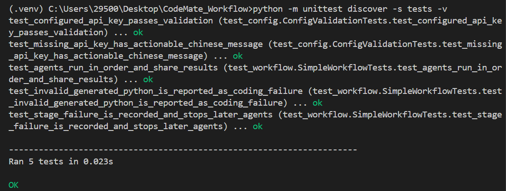
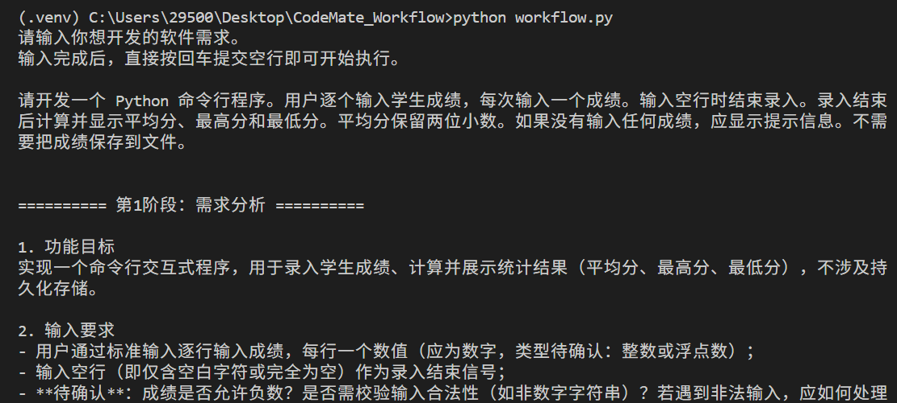
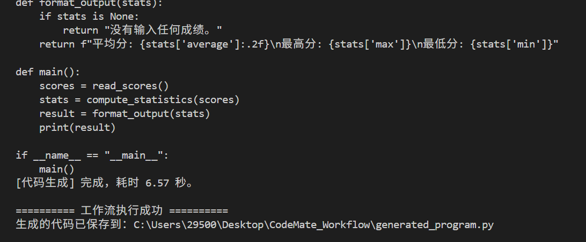
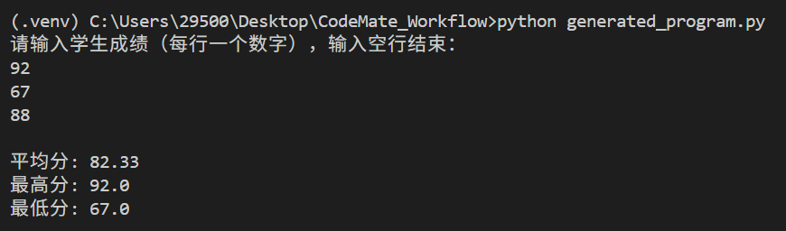

# CodeMate Workflow

CodeMate Workflow 是一个 Python 命令行 MVP，演示如何让多个 Agent 按顺序协作完成软件开发任务。工作流将用户需求依次交给需求分析、方案设计和代码生成 Agent，并把最终代码保存为 `generated_program.py`。

```text
用户需求 → 需求分析 Agent → 方案设计 Agent → 代码生成 Agent
                                                   ↓
                                      清理代码围栏并检查 Python 语法
                                                   ↓
                                      generated_program.py
```

## 功能

- 三个 Agent 通过共享状态和函数参数传递阶段结果。
- `WorkflowStage` 描述阶段名称、输出字段和执行函数；`SimpleWorkflow` 按阶段列表顺序执行，可配置或调整流程阶段。
- 每阶段检查输出是否为空，并记录阶段耗时；失败时记录阶段名称和错误信息，停止后续阶段。
- 默认代码生成阶段会清理 Markdown 代码围栏，并用 Python AST 检查语法。它不会执行生成的程序，也不能证明代码符合所有业务需求。
- 启动默认工作流前检查百炼 API Key；未配置时给出中文配置提示。
- 代码生成提示词要求交互式生成程序在读取输入前说明操作方式；具体生成结果仍由模型决定。

## 环境要求

- Python 3.10 或更高版本
- 阿里云百炼 API Key
- 可访问百炼兼容 OpenAI 的 API 服务

运行依赖见 `requirements.txt`：`openai` 和 `python-dotenv`。自动化测试使用 Python 自带的 `unittest`，不需要 pytest。

## 安装与配置

在项目根目录打开 PowerShell：

```powershell
python -m venv .venv
.\.venv\Scripts\Activate.ps1
python -m pip install -r requirements.txt
Copy-Item .env.example .env
```

编辑 `.env`，填入自己的 Key：

```text
DASHSCOPE_API_KEY=你的百炼API密钥
```

`.env` 已列入 `.gitignore`。不要把真实密钥提交到代码仓库。

当前模型配置在 `config.py`：百炼兼容接口地址和 `qwen-plus` 模型。缺少 Key 时，默认工作流会提示用户配置 `.env`。

## 测试

### 自动化测试

运行 mock 单元测试，不需要联网或 API Key，也不会调用真实模型：

```powershell
python -m unittest discover -s tests -v
```

覆盖内容包括 Agent 调用顺序与结果传递、阶段失败后的状态和停止行为、生成代码语法错误处理，以及 API Key 配置校验。




### 真实模型演示脚本

以下脚本会调用真实模型，需要先配置 API Key，并可能产生模型调用费用：

```powershell
python test_requirement_agent.py
python test_design_agent.py
python test_coding_agent.py
```

这些脚本分别演示单独的需求分析、需求分析加方案设计，以及三个 Agent 的代码生成过程。它们用于观察模型实际输出；`test_coding_agent.py` 不经过 `SimpleWorkflow`，因此不会覆盖工作流里的语法检查、阶段耗时和错误状态逻辑。

## 运行完整工作流

在项目根目录运行：

```powershell
python workflow.py
```

按提示输入软件需求。可以输入多行；输入空行并回车后开始工作流。终端会显示三个阶段的输出及各阶段耗时。成功时，代码保存到当前项目目录的 `generated_program.py`；再次成功运行可能覆盖该文件。

例如，可以输入：

```text
请开发一个 Python 命令行程序。
用户逐个输入学生成绩，每次输入一个成绩。
输入空行时结束录入。
录入结束后计算并显示平均分、最高分和最低分。
平均分保留两位小数。
如果没有输入任何成绩，应显示提示信息。
不需要把成绩保存到文件。
```





工作流只生成和保存代码，不会自动运行它。需要时可单独执行：

```powershell
python generated_program.py
```

根据生成程序自身的提示提供输入。程序的输入方式取决于用户需求和模型输出。



## 项目结构

```text
.
├── agents/
│   ├── model_agent.py          # 共享模型客户端封装
│   ├── requirement_agent.py    # 需求分析 Agent
│   ├── design_agent.py         # 方案设计 Agent
│   └── coding_agent.py         # 代码生成 Agent
├── tests/
│   ├── test_config.py          # API Key 配置校验测试
│   └── test_workflow.py        # mock 工作流测试
├── config.py                  # 模型参数与 API Key 校验
├── workflow.py                # 阶段配置、编排、状态和结果保存
├── test_requirement_agent.py  # 真实模型演示脚本
├── test_design_agent.py       # 真实模型演示脚本
├── test_coding_agent.py       # 真实模型演示脚本
├── generated_program.py       # 工作流生成的程序，可能被覆盖
├── requirements.txt
├── .env.example
├── README.md
└── DESIGN.md
```

## 当前限制

- Agent 的输出由模型生成，提示词不能保证每次都遵守格式或完全正确。
- AST 检查只验证 Python 语法，不会运行生成代码或验证其功能。
- 阶段状态和耗时保存在本次运行的内存中，并打印到终端；目前没有持久化日志、自动重试、自动恢复、并行执行或可视化编排界面。
- 默认流程是顺序执行。自定义阶段通过 `SimpleWorkflow(stages=[...])` 提供；每个阶段接收共享状态并返回非空字符串。

## 许可证与安全

项目不会把 `.env` 中的 API Key 写入生成程序。使用真实模型脚本会向百炼发送提示词和输入内容，请勿提交或输入不应发送给外部模型服务的敏感信息。
